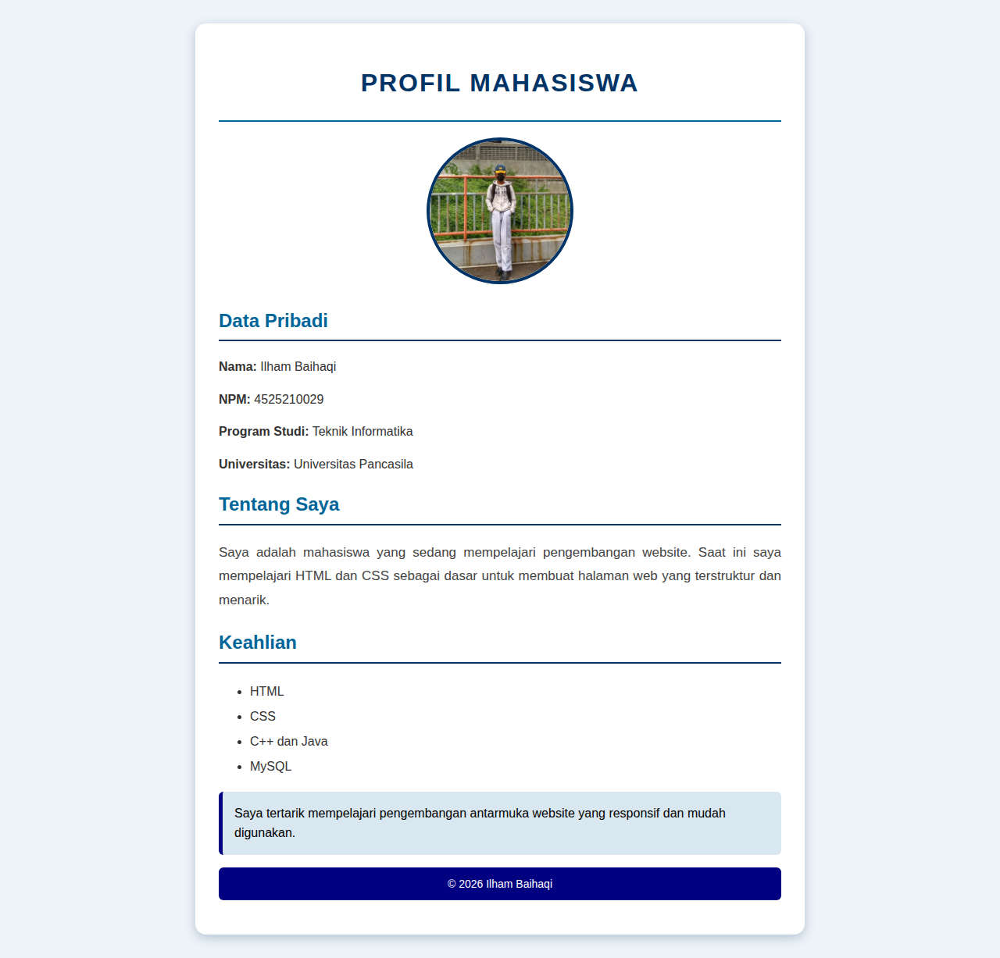
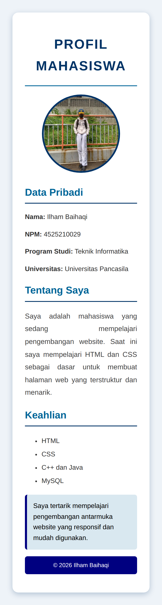

# Laporan Praktikum Desain Web A - Pertemuan 3

**Nama:** Ilham Baihaqi | **NPM:** 4525210029 | Teknik Informatika, Universitas Pancasila

## Tugas Individu: Profil dengan CSS Inline
Halaman profil Contoh 1 saya modifikasi menjadi kartu di tengah layar dengan foto bulat dan garis bawah pada subjudul. Menggunakan lebih dari 10 property CSS inline, antara lain `font-family`, `background-color`, `padding`, `border-radius`, `box-shadow`, `text-transform`, dan `letter-spacing`.

Semua gaya ditulis langsung pada atribut `style` di tiap elemen, sesuai ketentuan tugas. Empat format warna yang dipakai:
- Nama warna: `navy`, `white`
- HEX: `#003366`
- RGB: `rgb(0, 102, 153)`
- RGBA: `rgba(0, 102, 153, 0.15)`

| Desktop | Mobile |
|---|---|
|  |  |

## Tugas Kelompok: Mini Style Guide
Menampilkan panduan tampilan menggunakan external CSS: font Arial dan Georgia, warna utama `#003366`, warna aksen `#ff9800`, heading 32/24/18px, serta line-height 1.5 dan 1.8.

| Desktop | Mobile |
|---|---|
|  |  |

## Kendala
Menulis style inline berulang mudah salah ketik, dan path gambar sempat salah setelah folder diganti `images/`. Hasil sudah diperiksa pada tampilan desktop dan mobile. CSS inline cocok untuk uji coba cepat, sedangkan external CSS lebih mudah dirawat.
